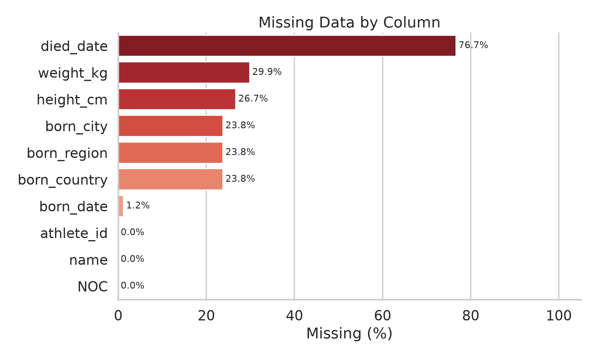
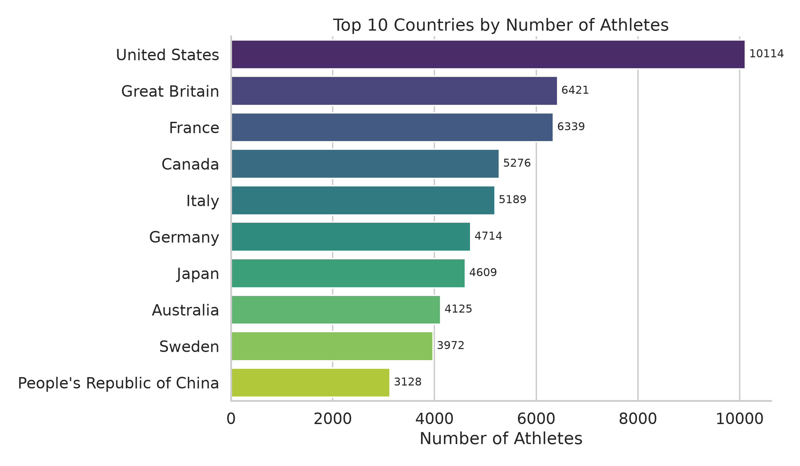
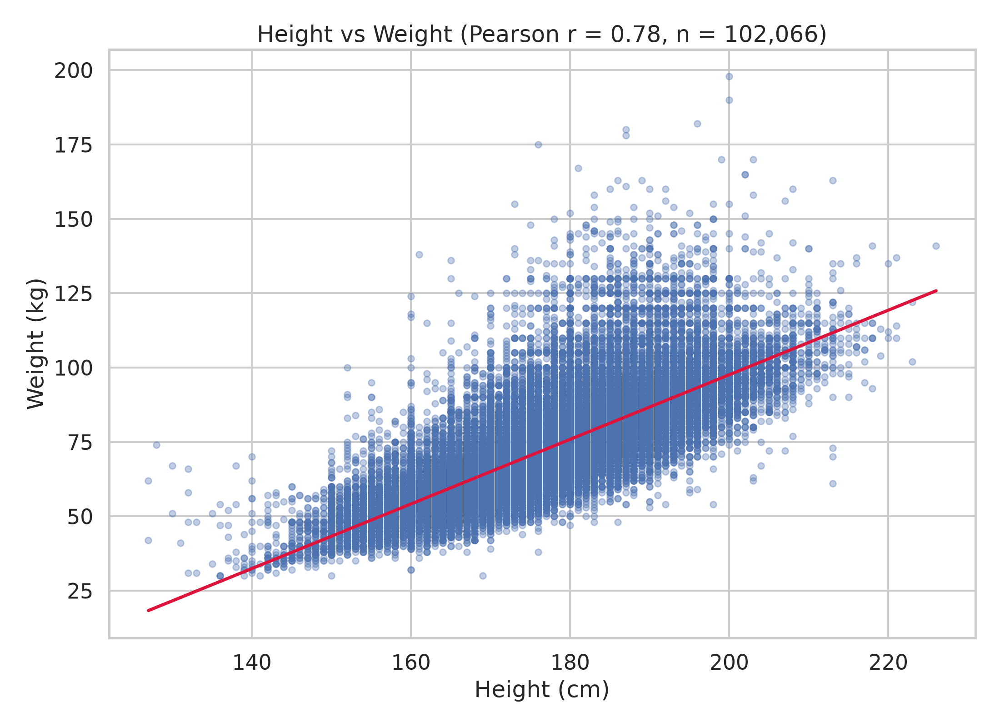
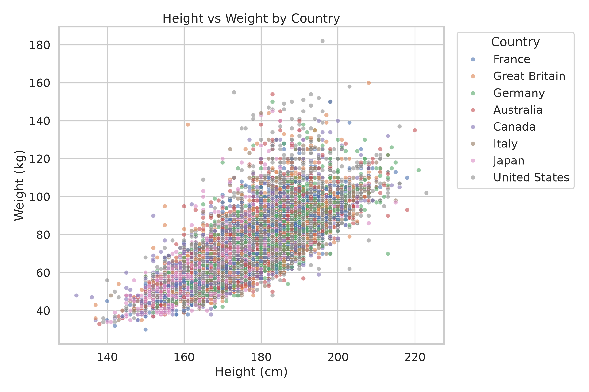
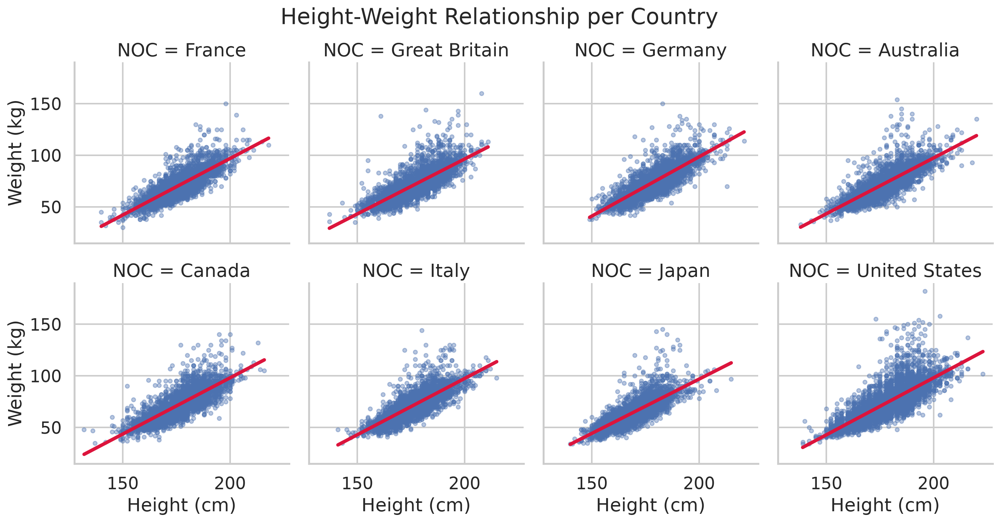
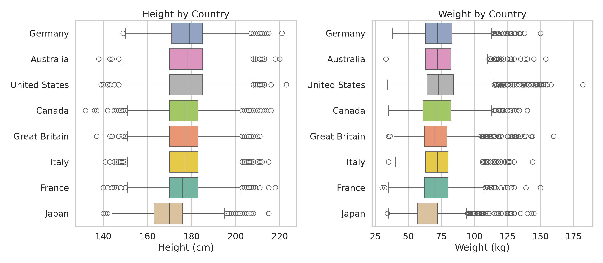
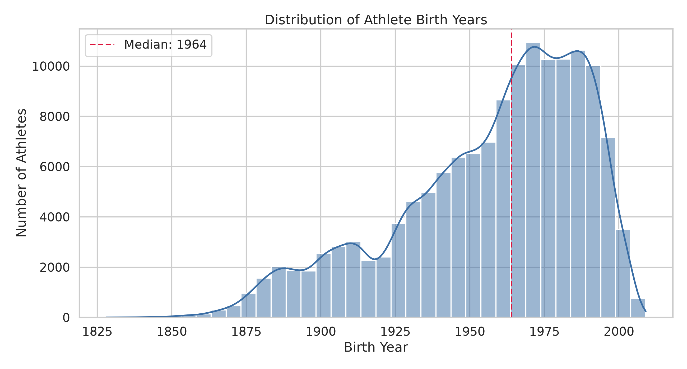
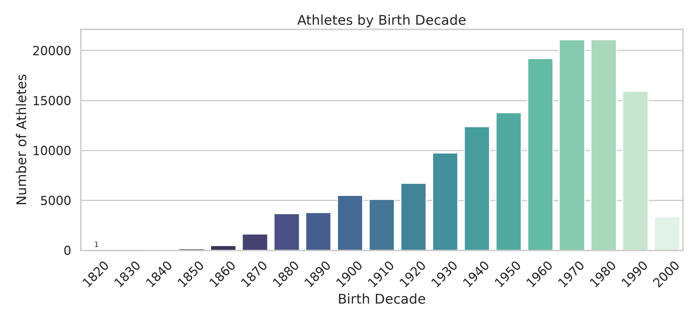
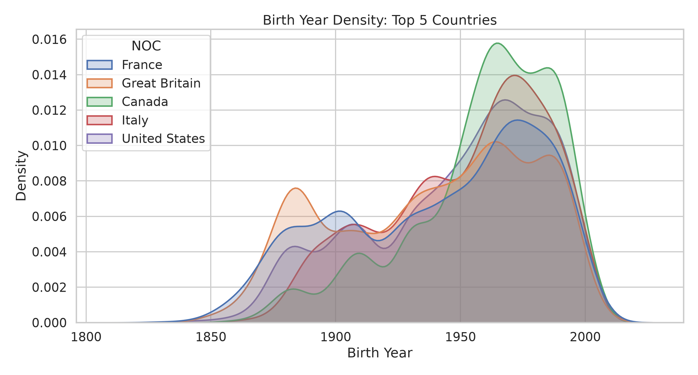

# Athlete Data Cleaning & EDA

Cleaning and exploratory analysis of a 150,000-row athlete dataset using Python, Pandas and Seaborn.

> **Note:** This is a sample project built on a public dataset, not a paid client job.

## Overview

The raw file contains 150,000 athlete records with missing and inconsistent values, which makes it slow and hard to work with in a standard spreadsheet. This project audits the data, cleans it, and turns it into 9 clear charts that show the main patterns.

## What I did

1. Audited all 150,000 rows for missing values before any analysis
2. Cleaned and standardized the records
3. Handled missing height and weight values and kept only complete records for the height vs weight analysis
4. Ranked countries by athlete count
5. Analyzed birth years and compared physical attributes across countries
6. Produced 9 charts for a report

## Key findings

- **Data quality:** 29.9% of weights and 26.7% of heights were missing. ID, name and country were 100% complete.
- **Top countries by athlete count:** United States (10,114), Great Britain (6,421), France (6,339).
- **Birth years:** The median birth year is 1964, with the most athletes born in the 1970s and 1980s.
- **Height vs weight:** Strong positive correlation (r = 0.78) across 102,066 complete records.
- **Country comparison:** Median height and weight differ across 8 major sporting nations, shown with boxplots that highlight outliers.

## Charts

### Data quality

*Share of missing values per column.*

### Countries

*Top 10 countries by number of athletes.*

### Height vs weight

*Height vs weight for all complete records.*


*Height vs weight by country, overlaid on one plot.*


*Height vs weight shown separately for each country.*


*Boxplots comparing median height and weight across countries, with outliers.*

### Birth years

*Distribution of athlete birth years.*


*Number of athletes by birth decade.*


*Birth year distribution compared across countries.*

## How to run

```bash
pip install -r requirements.txt
python athletes_analysis.py
```

Place the dataset file in the same folder as the script before running it.

## Tools used

Python, Pandas, Matplotlib, Seaborn

## Services I offer

Cleaning large Excel and CSV files, removing duplicates and fixing missing data, merging multiple spreadsheets into one clean file, and turning data into clear charts and summary reports.
